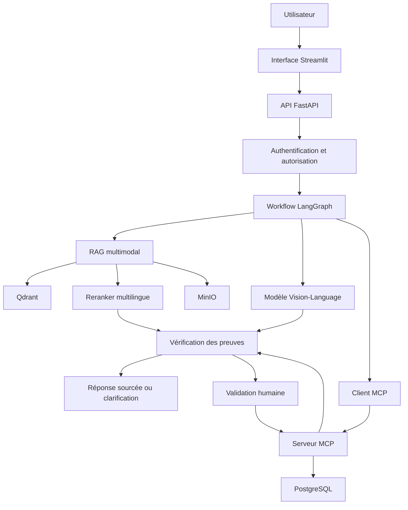

# MAINTiDOC AutoVision

### Assistant documentaire multimodal et agentique pour la maintenance automobile

**MAINTiDOC AutoVision** est un projet universitaire d'intelligence artificielle générative multimodale visant à développer un assistant intelligent capable d'exploiter des manuels techniques automobiles, d'analyser des photographies et des voyants de tableau de bord, et de fournir des réponses contextualisées accompagnées de références documentaires vérifiables.

Le projet combine **Retrieval-Augmented Generation (RAG)**, modèles Vision-Language (VLM), orchestration agentique avec **LangGraph** et intégration d'outils externes via **Model Context Protocol (MCP)**.

> **Statut :** Projet en cours de structuration et de développement.
>
> **Important :** MAINTiDOC AutoVision est un outil d'assistance documentaire. Il ne constitue pas un système de diagnostic automobile garanti et ne remplace pas les recommandations du constructeur ni l'intervention d'un professionnel qualifié.

---

## 1. Objectifs du projet

L'objectif principal est de concevoir un système capable d'assister les utilisateurs dans la compréhension des informations techniques liées à la maintenance automobile.

Les objectifs spécifiques sont :

- Interroger des manuels automobiles en langage naturel.
- Analyser des photographies, voyants et éléments visuels.
- Rechercher des informations dans un corpus documentaire multimodal.
- Générer des réponses fondées sur des sources vérifiables.
- Identifier les situations nécessitant une clarification.
- Consulter des historiques fictifs de maintenance via MCP.
- Préparer des tickets de maintenance soumis à validation humaine.
- Améliorer la pertinence documentaire par fine-tuning d'un reranker.
- Évaluer la qualité, la sécurité et les performances du système.
- Déployer un prototype reproductible avec Docker Compose.

## 2. Périmètre automobile

Le projet se concentre sur l'exploitation de la documentation technique automobile.

**Périmètre envisagé :**
- Constructeurs : Volkswagen et Toyota, sous réserve de validation.
- Modèles et années : à définir selon les documents disponibles.
- Langue documentaire privilégiée : français.
- Sources : manuels officiels, documents PDF et données autorisées.

**Types de données :**
- Manuels d'utilisation et d'entretien.
- Documentation des voyants de tableau de bord.
- Photographies de voyants et de défauts.
- Figures, tableaux et schémas techniques.
- Historiques fictifs d'interventions.

Le cahier des charges prévoit un corpus cible de **30 à 50 documents autorisés** couvrant deux familles d'équipements.

## 3. Fonctionnalités prévues

### 3.1 Assistant documentaire intelligent

L'utilisateur pourra poser une question telle que :

*« Que signifie ce voyant orange sur le tableau de bord de mon véhicule ? »*

Le système recherchera les passages pertinents dans les manuels autorisés et produira une réponse accompagnée de références aux documents, pages et figures.

### 3.2 Analyse multimodale

L'assistant exploitera conjointement :

- Les questions textuelles.
- Les photographies fournies par l'utilisateur.
- Les passages documentaires.
- Les images et figures extraites des manuels.

Un modèle Vision-Language à poids ouverts sera utilisé pour analyser les informations visuelles.

### 3.3 Recherche documentaire multimodale

Le moteur RAG intégrera :

1. Extraction de texte, tableaux et images.
2. OCR pour les documents scannés.
3. Découpage en passages documentaires.
4. Génération d'embeddings textuels et visuels.
5. Indexation dans Qdrant.
6. Recherche textuelle et visuelle avec filtrage des accès.
7. Fusion des résultats par Reciprocal Rank Fusion.
8. Reranking des passages pertinents.
9. Génération et vérification des réponses sourcées.

### 3.4 Orchestration agentique

LangGraph permettra de coordonner les différentes étapes du traitement :

- Vérification des permissions.
- Analyse de la question et de l'image.
- Recherche documentaire.
- Consultation éventuelle de l'historique.
- Vérification des preuves.
- Génération d'une réponse ou d'une clarification.
- Préparation éventuelle d'un ticket.
- Attente de validation humaine avant toute création.

### 3.5 Intégration MCP

Un serveur MCP de démonstration exposera trois outils :

| Outil | Fonction |
|---|---|
| `get_equipment_history` | Consulter l'historique des interventions |
| `get_open_tickets` | Consulter les tickets ouverts |
| `create_ticket` | Créer un ticket après approbation explicite |

Les historiques et les tickets seront fictifs. Les autorisations seront vérifiées côté serveur.

### 3.6 Fine-tuning ciblé

Le projet prévoit l'adaptation d'un petit reranker multilingue, sans fine-tuning du VLM dans le périmètre initial.

Trois configurations seront comparées :

1. Recherche sans reranker.
2. Recherche avec reranker préentraîné.
3. Recherche avec reranker adapté.

Les expériences et métriques seront suivies avec MLflow.

---

## 4. Architecture technique

L'architecture proposée repose sur une séparation modulaire des responsabilités.



Les contrôles d'accès s'appliquent également à la récupération et à l'affichage des documents. La création d'un ticket nécessite une approbation liée à l'utilisateur et au contenu exact.

### Technologies proposées

| Domaine | Technologies |
|---|---|
| Langage | Python |
| Backend | FastAPI, Pydantic |
| Frontend | Streamlit |
| Orchestration | LangChain, LangGraph |
| Modèle multimodal | Qwen2.5-VL-7B-Instruct |
| Inférence | Transformers, éventuellement vLLM |
| Base vectorielle | Qdrant |
| Embeddings textuels | BGE-M3 |
| Embeddings visuels | Encodeur multilingue compatible CLIP |
| Extraction PDF | PyMuPDF, OCR |
| Base de données | PostgreSQL |
| Stockage de fichiers | MinIO |
| Outils externes | MCP |
| Fine-tuning | Transformers |
| Suivi des expériences | MLflow |
| Déploiement | Docker, Docker Compose |
| CI/CD | GitHub Actions |

Ces technologies constituent la stack proposée. Les versions et compatibilités exactes seront validées pendant le développement.

---

## 5. Structure du dépôt

```text
MAINTiDOC-AutoVision/
├── .github/          # Workflows CI et modèles GitHub
├── backend/          # API FastAPI et services applicatifs
├── frontend/         # Interface Streamlit
├── ingestion/        # Extraction PDF, OCR et préparation
├── rag/              # Recherche hybride et reranking
├── vision/           # Analyse multimodale et VLM
├── agents/           # Workflows LangGraph
├── mcp_server/       # Historique et tickets de démonstration
├── training/         # Fine-tuning du reranker
├── evaluation/       # Évaluation et benchmarks
├── prompts/          # Prompts versionnés
├── data/             # Manifestes et échantillons autorisés
├── tests/            # Tests unitaires, intégration et sécurité
├── scripts/          # Scripts utilitaires
├── infra/            # Docker et monitoring
├── docs/             # Documentation technique
├── notebooks/        # Expérimentations
├── .gitignore
├── README.md
└── MAINTIDOC_PLAN.md
```

Les dossiers correspondent à l'architecture cible. Leur présence ne signifie pas que leurs fonctionnalités sont déjà implémentées.

Les PDF complets, datasets volumineux et poids de modèles ne seront pas systématiquement stockés dans GitHub. Leur stockage et leur distribution respecteront les licences applicables.

---

## 6. Installation et exécution

### Prérequis envisagés

- Git
- Python et environnement virtuel
- Docker et Docker Compose
- Accès aux modèles et aux documents autorisés
- GPU compatible, selon les résultats des benchmarks

### Cloner le dépôt

```bash
git clone https://github.com/farahhanti01/MAINTiDOC-AutoVision.git
cd MAINTiDOC-AutoVision
```

**Remarque :** le dépôt étant privé, le clonage nécessite un accès GitHub autorisé.

### Démarrage de l'application

Les commandes d'installation des dépendances, de configuration de l'environnement et de démarrage des services seront ajoutées après validation des fichiers de configuration et de l'implémentation Docker.

Aucune commande de lancement de l'application n'est annoncée comme opérationnelle à ce stade.

---

## 7. Plan de développement

Le projet est organisé en six sprints.

| Sprint | Objectif principal |
|---|---|
| Sprint 1 | Cadrage, architecture et corpus documentaire |
| Sprint 2 | Ingestion, OCR et recherche multimodale |
| Sprint 3 | VLM, génération sourcée, API et interface |
| Sprint 4 | LangGraph, MCP et approbation humaine |
| Sprint 5 | Fine-tuning, évaluation et sécurité |
| Sprint 6 | Docker, CI/CD, documentation et soutenance |

Le détail des responsabilités, tâches, dépendances, critères d'acceptation et checklists est disponible dans [MAINTIDOC_PLAN.md](MAINTIDOC_PLAN.md).

---

## 8. Évaluation et sécurité

Le cahier des charges prévoit environ **150 scénarios d'évaluation**, répartis entre :

- Questions documentaires textuelles.
- Questions nécessitant une image ou un schéma.
- Consultation MCP.
- Sources absentes ou contradictoires.
- Contrôle d'accès et validation humaine.
- Tentatives d'injection de prompt.

### Indicateurs

- Recall@5, nDCG@5 et MRR@10.
- Exactitude et fidélité des réponses.
- Validité des citations.
- Qualité de la gestion de l'incertitude.
- Pertinence des appels MCP.
- Résistance aux injections.
- Latences et consommation de ressources.

### Objectifs initiaux du cahier des charges

| Indicateur | Objectif proposé |
|---|---|
| Citations soutenant les affirmations | ≥ 90 % |
| Créations sans approbation dans les tests | 0 |
| Fuites entre groupes dans les tests | 0 |
| Latence p95 des demandes simples | < 30 secondes |

Ces valeurs sont des **objectifs à évaluer**, et non des performances déjà obtenues.

Les limites initiales prévues comprennent également trois appels MCP maximum, six appels au modèle maximum et 60 secondes de traitement automatique maximum par demande, hors attente humaine.

---

## 9. Démonstration prévue

La démonstration finale devra illustrer :

1. Une question accompagnée d'une photographie automobile.
2. Une réponse citant un manuel, une page et une figure.
3. Une consultation d'historique via MCP.
4. La préparation et l'approbation d'un ticket.
5. Une demande de clarification pour une image ambiguë.
6. Le refus d'un accès documentaire non autorisé.
7. Le blocage d'une tentative d'injection.
8. La présentation des résultats d'évaluation et des limites.

---

## 10. Équipe

Projet réalisé par :

**Farah Hanti**  
**MASBAH Ahmed**

La répartition détaillée des responsabilités figure dans le plan de développement.

---

## 11. État du projet

**Phase actuelle :** structuration du dépôt, planification et cadrage technique.

Les modules fonctionnels, expériences et résultats seront documentés au fur et à mesure de leur réalisation et de leur validation.

Ce README sera mis à jour à chaque étape importante du développement.

---

## 12. Références

- Cahier des charges universitaire : *Projet intégrateur d'IA générative multimodale — MAINTiDOC*.
- [LangChain](https://python.langchain.com/)
- [LangGraph](https://github.com/langchain-ai/langgraph)
- [Qdrant](https://qdrant.tech/)
- [Hugging Face Transformers](https://huggingface.co/docs/transformers/)
- [FastAPI](https://fastapi.tiangolo.com/)
- [Streamlit](https://streamlit.io/)
- [MLflow](https://mlflow.org/)
- [Model Context Protocol](https://modelcontextprotocol.io/)

---

**MAINTiDOC AutoVision — L'intelligence artificielle multimodale au service de la documentation et de la maintenance automobile.**